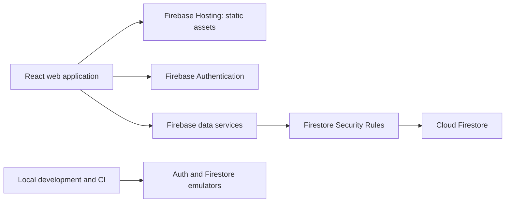

# CircleExchange web application architecture

Status: accepted for the initial pilot. Updated: 2026-11-02.
This document supersedes the previous React Native/Express/Clerk/Supabase plans.

## 1. Product and scope

CircleExchange is a responsive browser application for exchanging goods and services within approved communities. The primary interface is an authenticated workspace. The initial pilot serves one small community before supporting many communities.

First deliverable: accounts, verified email ownership, and private profiles.
Current milestone: automatic membership using verified, mapped company email domains. Residential communities and administrator approval are deferred.
Then: text listings, private messaging, completion tracking, and basic moderation.
Native mobile apps, social feeds, payments, subscription transfers, AI, uploads, and recommendation engines are deferred.

## 2. System boundaries

Hosting serves the application bundle. The browser signs in through Firebase Authentication and accesses Firestore directly using its authenticated SDK. Firestore rules are the authorization boundary; UI guards improve navigation but never authorize data access. There is no trusted browser code or custom JWT issuer.

Use component state for forms and a small authentication boundary. Add shared state only as real features need it. Keep Firebase calls in `frontend/src/services` so views do not depend on document layout and a future API can replace the implementation.

## 3. Free-tier operating constraints

Use the Spark plan and do not attach a billing account. Use classic Firebase Hosting, not Firebase App Hosting. The default Firebase hosting domain avoids domain-purchase costs. Email/password authentication avoids paid SMS. Authentication quotas and abuse limits still apply.

Firestore's standard free quota includes 1 GiB stored data, 50,000 reads/day, 20,000 writes/day, and 20,000 deletes/day. Only one database per project receives the free quota. These limits are capacity ceilings, not performance targets. See [Firestore quotas](https://firebase.google.com/docs/firestore/quotas).

Hosting includes 10 GB storage and 10 GB/month data transfer at no cost; on Spark, quota exhaustion can prevent deployment or interrupt serving. See [Hosting usage and pricing](https://firebase.google.com/docs/hosting/usage-quotas-pricing).

Cloud Storage requires Blaze, so file uploads are excluded. App Hosting and deployed Cloud Functions are also excluded from this Spark architecture. See [Storage billing requirements](https://firebase.google.com/docs/storage/faqs-storage-changes-announced-sept-2024), [pricing](https://firebase.google.com/pricing), and [plan behavior](https://firebase.google.com/docs/projects/billing/firebase-pricing-plans).

Operational rules:
- Page lists at 20 records with cursors; never download an entire community for search.
- Keep realtime listeners limited to the open conversation, with a bounded recent-message window and cleanup on navigation/sign-out.
- Use explicit refresh and cursor paging elsewhere until realtime is justified.
- Start with text listings and category filters. Full-text search requires a later design decision.
- Monitor usage in Firebase Console during the pilot; stop onboarding before quota pressure disrupts service.
- Do not enable paid products or billing automatically. Re-check pricing before launch and before each provider change.

## 4. Identity and community trust

Authentication UID is the stable user identifier. Firebase manages passwords, email verification and session tokens. Do not store passwords, tokens or email copies in public profile documents.

Email verification proves mailbox ownership. For explicitly mapped company domains, verified ownership grants ordinary membership automatically. Initial mappings: hp.com → HP and google.com → Google. This is not a claim of employment verification or employer endorsement.

Company onboarding has no manual approval step. Firestore rules derive company eligibility from signed, verified email claims. Work location and branch are optional self-reported details. Personal-email and residential approval workflows are deferred. See [COMPANY_ONBOARDING.md](COMPANY_ONBOARDING.md) for the authoritative membership contract, revocation behavior and verification limits.

## 5. Data model

Implemented: private profiles and own company membership records. The HP/Google directory is static; no parent community documents or seed operation are required. Other paths remain denied.

| Path | Fields and purpose | Access policy when implemented |
| --- | --- | --- |
| `users/{uid}` | `displayName`, `createdAt`, `updatedAt` | Owner reads; verified owner creates/edits; exact field allowlist |
| `communities/{communityId}` | Name, description, active status | Approved directory metadata only; administrator changes |
| `communities/{id}/joinRequests/{uid}` | Applicant, pending/approved/rejected, timestamps | Applicant creates pending request; same-community admin reviews |
| `communities/{id}/members/{uid}` | Verified domain, member role, active/revoked status, optional work location/branch, timestamps | Exact verified domain auto-enrollment; own reads and work-detail updates; no client role changes or deletion |
| `communities/{id}/listings/{listingId}` | Seller UID, title, description, category, amountMinor, currency, active/reserved/sold status, timestamps | Active members read; verified active seller creates; owner edits |
| `communities/{id}/conversations/{conversationId}` | Listing ID, buyer UID, seller UID, timestamps | Exactly the participants, with active membership |
| `.../conversations/{id}/messages/{messageId}` | Sender UID, plain text, createdAt | Participants only; sender must match auth UID; immutable messages initially |
| `communities/{id}/reports/{reportId}` | Reporter, target, reason, status | Members create; admins read/review; no public report exposure |

Firestore document IDs are not secrets. Use random SDK-generated IDs. Each feature needs rules that validate relationships, allowed fields, types, lengths, immutable identity fields, timestamps, and status transitions. Rules are not query filters: client queries must satisfy their authorization constraints.

Use integer minor currency units, never floating-point accounting. Choose the pilot currency explicitly at listing implementation. Model category as `goods | services` initially; do not reuse the same field for delivery mode. A shared TypeScript model and tested Firestore converters will define the contract.

## 6. First milestone behavior

1. User creates an email/password account.
2. A verification screen explicitly offers to send/resend the email; delivery failure never appears as failed account creation.
3. User opens the verification link, returns and refreshes verification. The app refreshes the ID token before writing verified-only data.
4. User loads and saves their display name in a private profile.
5. Supported company users are enrolled automatically and may save work location/branch. Other users see a waiting state. Trading is not yet available.

Profile saves use a transaction to preserve `createdAt` during retries or concurrent first saves. Server timestamps prevent forged dates. Failed reads have a retry state rather than inviting overwriting an unseen profile. Sign-out clears the rendered account view; no persistent Firestore browser cache is enabled.

## 7. Security and operations

- Default deny across all unknown documents. Profiles have an exact field allowlist, so clients cannot assign admin or verification fields.
- Verify authorization with emulator tests for anonymous, unverified, other-user and privileged-field attempts.
- Firebase browser configuration is public application configuration, not a service account credential. Security rests on rules. Never include Admin SDK keys in Vite variables.
- Use authenticated provider APIs, generic account recovery responses, and Firebase abuse controls. Configure password policy and email enumeration protection before production.
- Evaluate App Check and enforce it after testing the selected provider and its quota; it supplements rules, not membership checks.
- No HTML rendering from user input. Add field-size limits for each new feature.
- No role management, irreversible account deletion, moderation authority, or payment handling until its security workflow exists.
- A pilot launch requires a privacy notice, support contact and manual data deletion/export procedure. Automated backups and deletion workflows are later work; do not promise them today.

## 8. Development, testing, deployment

One root package and committed pnpm lockfile. Frontend lives in `frontend/`. Firebase rules/configuration live at the root. Node 24 and Java 21 are the CI baseline.

Local emulators use only `demo-circleexchange`. The client rejects accidental live-project configuration in emulator mode. Test project data is disposable and does not access production. CI runs lint, component/config tests, a production build and real Firestore emulator rule tests without cloud credentials.

Production uses explicit Firebase project selection. Build and deploy rules before publishing Hosting. The deployment procedure must reject emulator mode and missing configuration. CI deploys successfully validated main commits automatically. Feature branches cannot deploy; billing changes are not automated.

## 9. Growth after funding

Keep the same browser application and stable IDs. Introduce trusted server functions only for features that require secrets, reliable background jobs or privileged workflows. Add storage for images with strict size/type/access controls. Introduce payments only after transaction, refund and moderation flows are defined. Evaluate search and observability against measured demand. Firestore can remain the database; a later SQL migration would require a deliberate data migration rather than a frontend rewrite.

Funding is a checkpoint for revisiting cost and operations, not a reason to prematurely add services.
